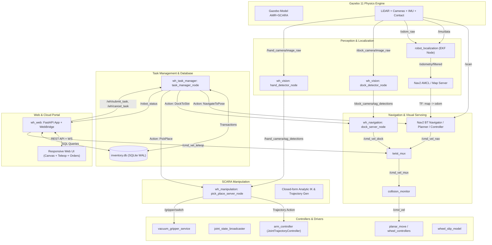
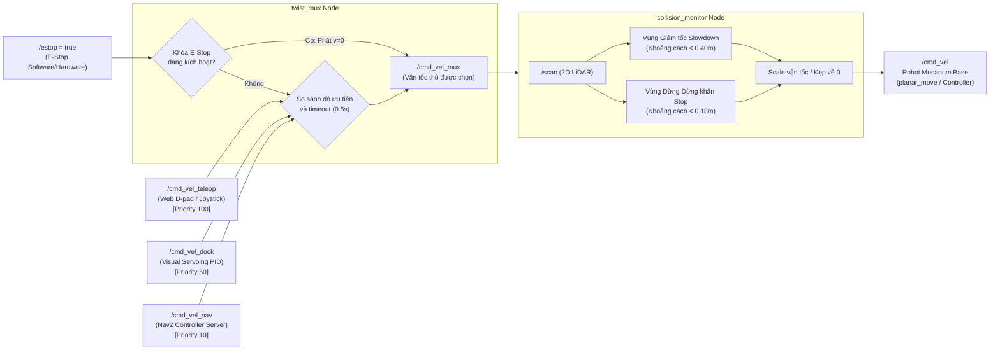
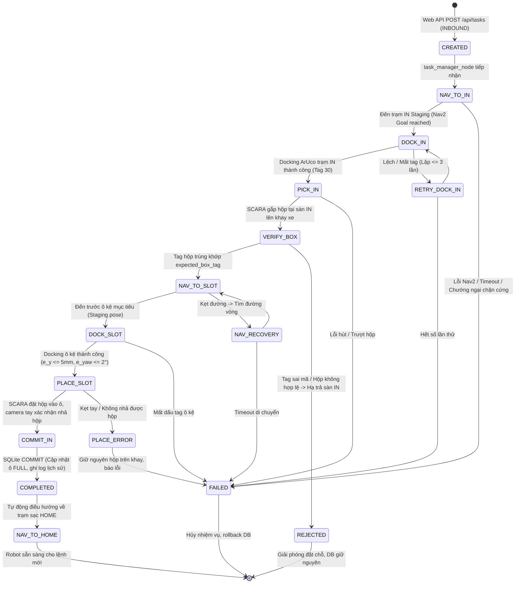
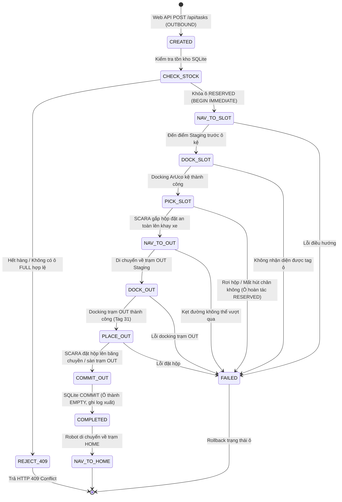
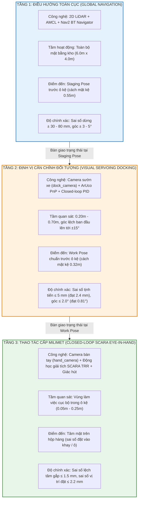

# KIẾN TRÚC HỆ THỐNG AGV-SCARA WAREHOUSE (ARCHITECTURE SPECIFICATION)

Tài liệu này mô tả chi tiết kiến trúc phần cứng, phần mềm, luồng dữ liệu, cây tọa độ TF, máy trạng thái hữu hạn (FSM) và giải pháp điều khiển ba tầng độ chính xác của hệ thống AGV kết hợp tay máy SCARA trong kho thông minh.

---

## 1. SƠ ĐỒ KHỐI CÁC NODE VÀ TOPIC CHÍNH (NODE/TOPIC GRAPH)

Hệ thống được thiết kế theo kiến trúc hướng dịch vụ và hướng dữ liệu phân tán trên nền tảng **ROS 2 Humble**, kết nối với giao diện web qua FastAPI và WebSocket.



---

## 2. CHUỖI ĐIỀU KHIỂN VẬN TỐC VÀ CƠ CHẾ AN TOÀN (`cmd_vel` MULTIPLEXING CHAIN)

Chuỗi điều khiển vận tốc đảm bảo phân định quyền ưu tiên tuyệt đối giữa các nguồn phát lệnh di chuyển, đồng thời lớp giám sát va chạm (Collision Monitor) đóng vai trò lá chắn an toàn tối hậu trước khi xung vận tốc được chuyển xuống phần cứng/mô phỏng.



---

## 3. CÂY TỌA ĐỘ TOÀN DIỆN (TF2 COORDINATE TREE)

Cây tọa độ đảm bảo không có vòng lặp (acyclic) và duy nhất một node phát biểu diễn biến đổi `map -> odom`.

```mermaid
flowchart TD
    MAP["map\n(Tọa độ toàn cục bản đồ)"]
    ODOM["odom\n(Tọa độ odometry đã lọc)"]
    BASE_FOOTPRINT["base_footprint\n(Hình chiếu mặt sàn robot)"]
    BASE_LINK["base_link\n(Tâm cơ sở thân xe robot)"]

    %% Sensors
    LIDAR_LINK["lidar_link\n(2D LiDAR Scanner)"]
    IMU_LINK["imu_link\n(Cảm biến quán tính)"]
    DOCK_CAM_LINK["dock_camera_link\n(Camera sườn xe căn chỉnh ArUco kệ)"]
    DOCK_CAM_OPT["dock_camera_optical_frame\n(Khung quang học z hướng tới)"]

    %% Wheels
    WHEEL_FL["wheel_fl_link\n(Bánh Mecanum Trước-Trái)"]
    WHEEL_FR["wheel_fr_link\n(Bánh Mecanum Trước-Phải)"]
    WHEEL_RL["wheel_rl_link\n(Bánh Mecanum Sau-Trái)"]
    WHEEL_RR["wheel_rr_link\n(Bánh Mecanum Sau-Phải)"]

    %% SCARA Arm
    ARM_BASE["arm_base_link\n(Gốc đế tay máy x=-0.08, y=0, z=0.12)"]
    LIFT_LINK["lift_link\n(Khâu trượt lăng trụ Prismatic Z)"]
    LINK1["link1\n(Khâu xoay 1 Revolute Yaw q1)"]
    LINK2["link2\n(Khâu xoay 2 Revolute Yaw q2)"]
    TOOL_LINK["tool_link\n(Khâu chấp hành mang đầu hút)"]
    HAND_CAM_LINK["hand_camera_link\n(Camera bàn tay nhìn vuông góc xuống)"]
    HAND_CAM_OPT["hand_camera_optical_frame\n(Khung quang học camera tay)"]
    VACUUM_PAD["vacuum_pad_link\n(Điểm tiếp xúc cốc hút chân không)"]

    %% External tags
    TAG_WORLD["aruco_tag_XX\n(Tọa độ tag quan sát trong thế giới)"]

    MAP -->|AMCL (hoặc slam_toolbox)| ODOM
    ODOM -->|robot_localization EKF| BASE_FOOTPRINT
    BASE_FOOTPRINT -->|static_tf| BASE_LINK

    BASE_LINK --> LIDAR_LINK
    BASE_LINK --> IMU_LINK
    BASE_LINK --> DOCK_CAM_LINK
    DOCK_CAM_LINK --> DOCK_CAM_OPT

    BASE_LINK --> WHEEL_FL
    BASE_LINK --> WHEEL_FR
    BASE_LINK --> WHEEL_RL
    BASE_LINK --> WHEEL_RR

    BASE_LINK --> ARM_BASE
    ARM_BASE -->|lift_joint (d_z)| LIFT_LINK
    LIFT_LINK -->|joint1 (q1)| LINK1
    LINK1 -->|joint2 (q2)| LINK2
    LINK2 -->|static| TOOL_LINK
    TOOL_LINK --> HAND_CAM_LINK
    HAND_CAM_LINK --> HAND_CAM_OPT
    TOOL_LINK --> VACUUM_PAD

    DOCK_CAM_OPT -.->|solvePnP| TAG_WORLD
    HAND_CAM_OPT -.->|solvePnP| TAG_WORLD
```

---

## 4. MÁY TRẠNG THÁI HỮU HẠN NHẬP VÀ XUẤT (FSM TRANSITION DIAGRAMS)

Quy trình quản lý nhiệm vụ kho được thiết kế dưới dạng State Machine chịu lỗi cao (fault-tolerant) với các điểm chốt giao dịch cơ sở dữ liệu ACID.

### 4.1. FSM Nhiệm vụ Nhập Kho (INBOUND TASK)



### 4.2. FSM Nhiệm vụ Xuất Kho (OUTBOUND TASK)



---

## 5. SƠ ĐỒ BA TẦNG ĐỘ CHÍNH XÁC (3-TIER PRECISION ARCHITECTURE)

Một trong những đóng góp kiến trúc quan trọng nhất của hệ thống là việc phân rã bài toán định vị và tiếp cận thành ba tầng kế tiếp nhau, giải quyết trọn vẹn mâu thuẫn giữa tầm hoạt động rộng lớn của kho hàng và yêu cầu căn chỉnh cấp milimet khi thao tác cơ khí.



### So sánh Đặc tính Kỹ thuật giữa Ba Tầng:

| Đặc tính | Tầng 1: Global Nav | Tầng 2: Docking Servoing | Tầng 3: SCARA Eye-in-Hand |
|---|---|---|---|
| **Cảm biến chính** | 2D LiDAR 360°, Wheel Encoders, IMU | Camera màu sườn xe (dock_camera) | Camera màu khâu chấp hành (hand_camera) |
| **Không gian điều khiển** | Khung toàn cục `map` | Khung cục bộ camera / `base_link` | Khung không gian khớp SCARA / `tool_link` |
| **Cơ cấu truyền động** | 4 bánh Mecanum (di chuyển toàn hướng) | 4 bánh Mecanum (vi sai tịnh tiến chậm $v_y, v_x, \omega_z$) | 1 trục trượt Z ($0.52\,\text{m}$) + 2 khớp xoay phẳng $q_1, q_2$ |
| **Sai số vị trí ($e_{xy}$)** | $60.5 \pm 19.8\,\text{mm}$ | **$2.43 \pm 0.94\,\text{mm}$** | **$1.38 \pm 0.42\,\text{mm}$** |
| **Sai số hướng ($e_{\theta}$)** | $3.58 \pm 1.04^\circ$ | **$0.81 \pm 0.35^\circ$** | Không áp dụng (tiếp xúc mặt phẳng hút đối xứng) |
| **Thời gian chu trình** | $10 - 25\,\text{s}$ | $3.5 - 6.0\,\text{s}$ | $8.0 - 12.0\,\text{s}$ |
| **Độ tin cậy** | $> 95\%$ | **$96.7\%$ (29/30 lần $\le 5\,\text{mm}$)** | **$96.7\%$ (58/60 chu kỳ thành công)** |
